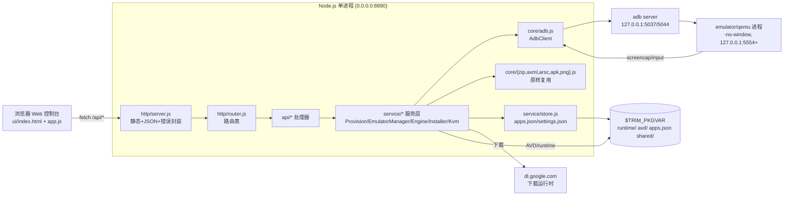
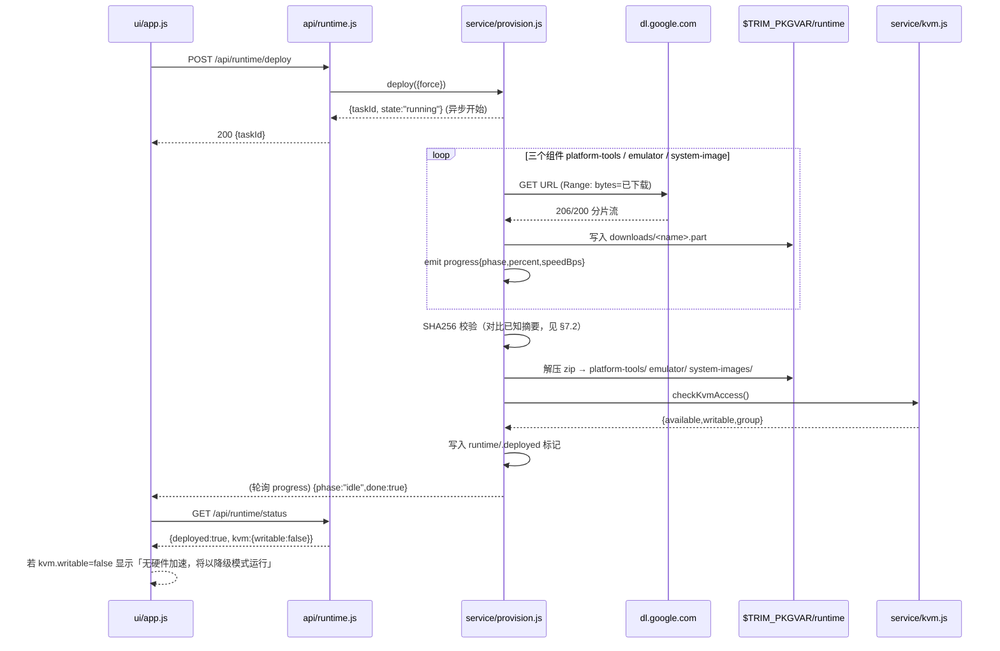
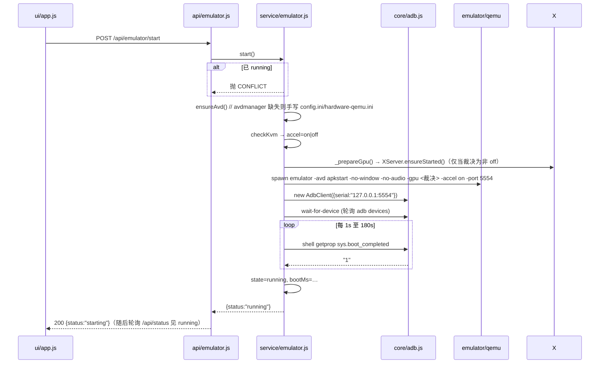
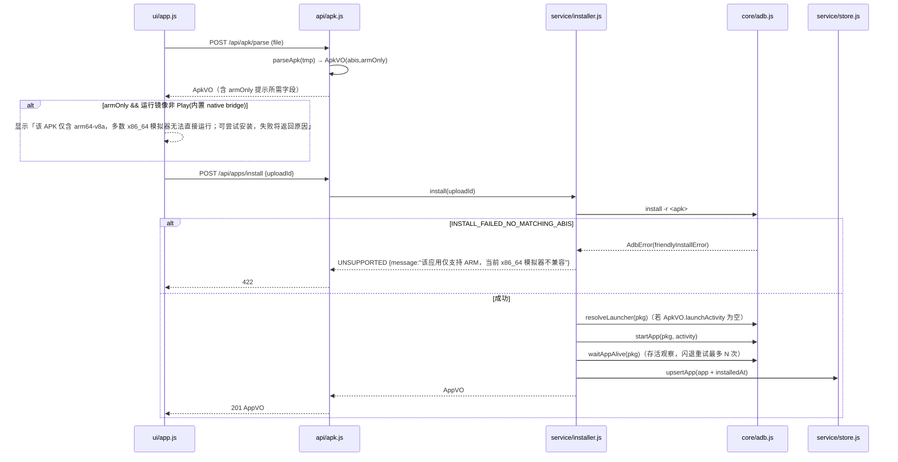
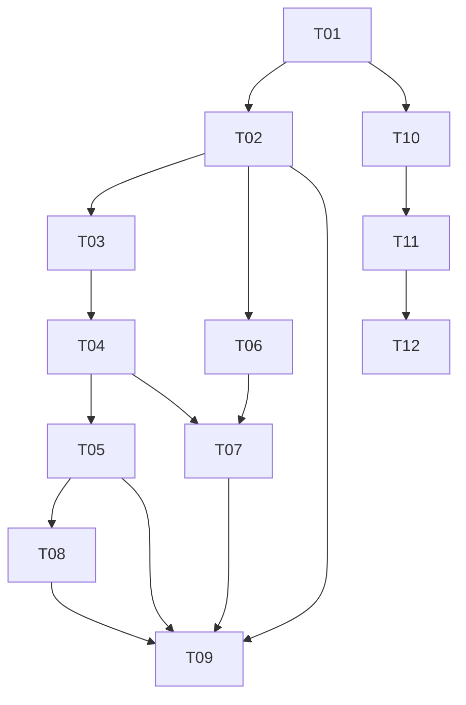
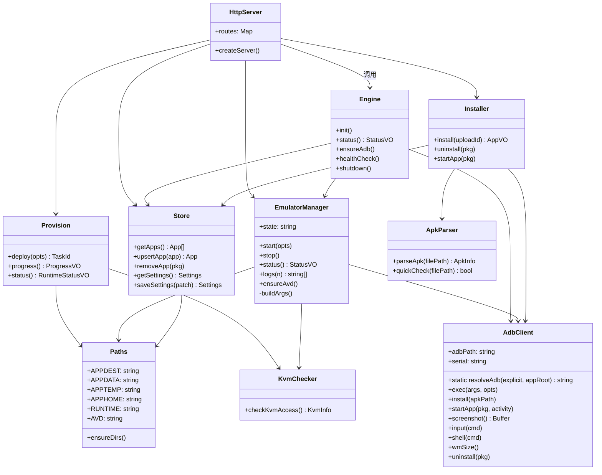

# ApkStart for fnOS · 系统架构设计（ARCH）

> 作者：架构师 高见远 · 输入：`docs/fnos/recon.md`、`docs/fnos/PRD.md`、`docs/fnos/decisions.md`、上游源码（只读）
> 读者：工程师 寇豆码（照此一次性实现）。本文所有文件路径、函数签名、接口契约均为最终定稿，不得擅自改名。

---

## 0. 一句话方案

把上游 Electron「解析 APK → 部署运行时 → adb 装应用 → Win32 窗口展示」链路，重写为 **单进程 Node.js HTTP 服务**：解析层原样复用，运行层改为 **Linux emulator（QEMU）+ KVM 无头运行**，展示层改为 **浏览器 `` 拉 `adb exec-out screencap -p` + `adb shell input` 注入**，以标准 fpk 交付、GitHub Actions 自动打包、发布到 fnDepot。

**不可动摇的边界（来自 decisions.md，不得推翻）**
- 技术栈：**Node.js 22 + 原生 HTML/CSS/JS，零第三方运行时依赖**。
- 后端单进程，端口 **8890**，监听 `0.0.0.0`；adb server 与 emulator console **只绑 `127.0.0.1`**。
- 解析层 `core/{zip,axml,arsc,apk,png}.js` **原样复制，不改逻辑**。
- 单实例共享一台模拟器跑多应用（Q3）；在线包，不含运行时二进制（Q2）；P0 不做鉴权（Q1）；`config/privilege` 声明 `join-groups:["all.editor","render","video"]` 即获得 `/dev/kvm`（属组 `all.editor`）与 `/dev/dri/renderD128`（属组 `render`）读写权，运行时仍检测可写性（Q4）；图形渲染默认 `gpu: 'auto'`——**权限早已不是瓶颈**，唯一门槛是宿主有没有「带硬件 3D 的 X display」（只有 `Xkasmvnc` 支持 `-hw3d`）；因 GPL-2.0 与其 deb 依赖，二进制**不随包携带**，由运维投放到 `$TRIM_PKGVAR/runtime/xserver/`，投放了就自动上 `-gpu host`（实测 −2.86s / −12.0%），没投放就安静回落 `off`，详见 IMPL 偏差 5 改造方案（Q4）；`maintainer` 保留 `RoutineMiku`、`distributor: TaroCats`（Q5）。

---

## 1. 实现方案总览

### 1.1 核心挑战与选型

| 挑战 | 方案 | 依据/取舍 |
|---|---|---|
| 无图形界面下跑 Android | Linux 版 `emulator`（QEMU）`-no-window` 无头 | 目标机已装 `libx11/libpulse/libgbm/libxcb/...`，emulator 依赖齐备（decisions 补充事实） |
| 硬件加速 | 优先 `/dev/kvm`（`-accel on`）；检测失败降级 `-accel off`（TCG，慢但能跑） | Q4 实测：`/dev/kvm` 属 `root:all.editor 0660`；`config/privilege` 的 `join-groups:["all.editor"]` 使包用户进组后 `KVM_WRITABLE` 校验通过；仍保留运行时检测以在未生效时降级 |
| 图形渲染 | 默认 `-gpu off` 纯软件渲染（实测开机 30.9~31.3s） | Q4 实测更正：**不是权限决定论**。宿主侧 GL 的真实门槛是「一个带硬件 3D 的 X display」+ `renderD128` 可读，二者齐备时包用户也能 `-gpu host`（`Mesa Intel (ADL-N)`，27.6~28.6s）；但宿主自带的 `Xvnc`/`Xvfb` 都不支持 `-hw3d`，唯 KasmVNC 的 `Xkasmvnc` 支持且不在宿主 PATH 里 → 本包不自带，故默认 `off`。详见 IMPL 偏差 5 更正 |
| 画面呈现 | `adb exec-out screencap -p` 取 PNG，HTTP 输出 `/api/screen/frame`，浏览器 `` 轮询 2fps | 零依赖，无需 WebSocket（P2 可换） |
| 输入注入 | 浏览器坐标 → 按 `wm size` 比例换算 → `adb shell input tap/swipe/text`；中文走 `adb shell ime`/base64 广播备用路径 | P0-8 |
| adb 客户端 | 复制 `core/adb.js`，仅改 `resolveAdb`（`adb.exe`→`adb`、Linux 路径）+ 内联 `input` 白名单（`pointer.js` 不迁移） | recon：唯一硬编码点在 `resolveAdb` |
| 运行时获取 | 联网下载 `platform-tools`/`emulator`/`system-images;android-34;google_apis;x86_64` 到 `$TRIM_PKGVAR/runtime`，支持断点续传 + SHA256 | Q2 在线包 |
| Node 运行时 | 见 §5.0：`cmd/main` 内 `resolve_node()` 探测，不要求用户手装 | 硬性约束 |

**Node 运行时获取方案（硬性要求，详见 §5.0）**：`cmd/main` 中的 `resolve_node()` 依次探测：① `$NODE_BIN` 显式覆盖 → ② `/usr/local/bin/node`（目标机实测存在 v22）→ ③ `command -v node`（PATH，可能是 fnOS nodejs 应用提供的软链）→ ④ 扫描 `/var/apps/nodejs*/target/bin/node`。命中即用；全部失败则打印中文错误（含安装 fnOS「Node.js」应用的建议）退出码 1。fpk 侧在 `manifest` 声明对 nodejs 的依赖（见 §7.3），**不要求用户手动装 Node**。

### 1.2 架构模式

- **分层**：`HTTP API 层（api/*）` → `服务层（service/*）` → `平台适配层（core/adb.js + service/emulator.js + service/provision.js）` → `外部进程（adb server / emulator / qemu）`。
- **单例状态**：`EmulatorManager` 与 `Engine` 各一个进程内单例，由 `server/index.js` 持有；HTTP 并发请求通过单例共享状态（单实例模型 Q3 的必然结果）。
- **错误统一**：所有 API 错误经 `http/server.js` 的 `sendError()` 输出 `{code, message}`（message 必中文），HTTP 状态码语义化（400/404/409/500/503）。

### 1.3 组件图



### 1.4 运行环境依赖与权限（目标机实测，硬约束，非可选优化）

> 来源：目标机 `10.31.0.4` 现场核实；`config/privilege` 的 `join-groups:["all.editor"]` 是拿到 KVM 的唯一手段，**无需任何本地 `usermod` 脚本**。

| 依赖 | 实测现状 | 结论（写死） |
|---|---|---|
| `/dev/kvm` | `crw-rw---- root all.editor 10,232`；包用户 `uid=926(apkstart-fnos)` 加入 `all.editor` 后 `KVM_WRITABLE` 校验通过 | `-accel on` 硬件加速可跑；加入该组靠 `config/privilege` 的 `join-groups:["all.editor"]`（注意目标机 `kvm:x:104` 组存在但为空、与设备无关，**别加 `kvm` 组**） |
| `/dev/dri/renderD128` | `crw-rw---- root render 226,128`，`render` 组内仅 `marvis-app`；出厂态包用户不可得 | 设备本身**不是**瓶颈：加入 `render` 组后包用户可正常 open（qemu 实测持有 6 个 fd）。但仅此不够——还需 `video`（`card0`）与一个**带 `-hw3d` 的 X display**，后者宿主不自带 → 默认 `-gpu off`。详见 IMPL 偏差 5 更正 |
| 系统共享库 | `libx11-6 / libpulse0 / libgbm1 / libxcb1 / libxext6 / libxcomposite1 / libnss3 / libasound2` 均已安装 | emulator 无头运行依赖齐备，无需额外装包 |
| Node 运行时 | 系统 `/usr/local/bin/node` v22 存在，但 fpk 不硬依赖 | 见 §5.0 `resolve_node()` 探测链 |
| 说明端口 | adb server 仅 `127.0.0.1`；emulator console `127.0.0.1:5554+` | 均不对外暴露，仅 Web 控制台 `0.0.0.0:8890` 对内网开放 |

**一句话**：`all.editor` 决定能否 KVM 加速，这是权限模型下的确定结论；图形渲染则**不是**——GPU 可跑通，卡点在「宿主缺一个带硬件 3D 的 X display」，且收益只有 ~3s（IMPL 偏差 5 更正）。

---

## 2. 完整文件列表

> 路径相对仓库根。标注：**新建 N** / **复制复用 R**（原样）/ **复制小改 R\*** / **不迁移 ✗**。
> 打包时 `build/pack.sh` 把 `server/`、`ui/`、`core/` 拷入 `fnos/app/`，源目录不放 fpk 骨架里。

### 2.1 复用解析层与 adb（`core/`）——复制进 `fnos/app/core/`

| 文件 | 处置 | 职责 | 预估行 |
|---|---|---|---|
| `core/zip.js` | R（原样） | 零依赖 ZIP 读取 | 236 |
| `core/axml.js` | R | 二进制 AndroidManifest 解析 | 167 |
| `core/arsc.js` | R | resources.arsc 解析 | 233 |
| `core/apk.js` | R | 包名/版本/launcher/图标/ABI 汇总 → `parseApk(filePath)`、`quickCheck(filePath)` | 190 |
| `core/png.js` | R | `encodePng`、`drawAppIcon(size)` | 132 |
| `core/adb.js` | R\* | `AdbClient`：`resolveAdb` 改 Linux 路径；`input()` 的 `require('./pointer')` 换为 `require('./inputguard')` | 815 |
| `core/inputguard.js` | N | 从上游 `pointer.js` 抽出 `isInputCommand(cmd)` 白名单（tap/swipe/text/keyevent/input） | 40 |

> **R\* 改动清单（`core/adb.js` 仅此两处）**：① 第 139–149 行 `resolveAdb(explicit, appRoot)`：候选改为 `[explicit, appRoot/runtime/platform-tools/adb, '/usr/local/bin/adb', 'adb']`，去掉所有 `adb.exe`；② 第 248 行 `require('./pointer')` → `require('./inputguard')`。其余 800+ 行不动。

### 2.2 后端（`server/`）——复制进 `fnos/app/server/`

| 文件 | 处置 | 职责 | 预估行 |
|---|---|---|---|
| `server/index.js` | N | 进程入口：加载 config → 构造单例 → 启动 HTTP → 注册 SIGTERM/优雅退出 | 120 |
| `server/config.js` | N | 解析 `TRIM_*` → `PATHS` 常量对象 + 默认端口/参数；`ensureDirs()` | 150 |
| `server/http/server.js` | N | `createServer()`：静态文件（ui）+ `/api` 分派 + JSON body 读取 + `sendJson/sendError/sendPng` | 220 |
| `server/http/router.js` | N | 路由表：`{ 'METHOD /path': handler }` + 参数化路径匹配 `:pkg` | 130 |
| `server/api/health.js` | N | `GET /api/health`、`GET /api/status` | 90 |
| `server/api/settings.js` | N | `GET/PUT /api/settings` | 70 |
| `server/api/runtime.js` | N | `POST /api/runtime/deploy`、`GET /api/runtime/deploy/progress`、`GET /api/runtime/status` | 150 |
| `server/api/emulator.js` | N | `POST /api/emulator/start|stop`、`GET /api/emulator/logs` | 130 |
| `server/api/apk.js` | N | `POST /api/apk/parse`（上传+解析） | 150 |
| `server/api/apps.js` | N | 应用列表/安装/启动/停止/卸载 | 190 |
| `server/api/screen.js` | N | 帧、尺寸、tap/swipe/text/key | 160 |
| `server/service/store.js` | N（改自上游 store.js） | `apps.json`/`settings.json` 读写，路径取数据根 `$TRIM_PKGVAR`（回退 `$TRIM_APPDATA` → `$HOME/.apkstart`） | 160 |
| `server/service/kvm.js` | N | `checkKvmAccess()`：`/dev/kvm` 存在性 + 可写性 + 组检测 | 70 |
| `server/service/provision.js` | N | `Provision` 类：下载 platform-tools/emulator/system-image，续传+SHA+解压，进度事件 | 300 |
| `server/service/emulator.js` | N | `EmulatorManager`：AVD 创建、启动参数、boot_completed 等待、stop/kill、日志环形缓冲、`_prepareGpu()` 与 `-gpu off` 降级重试 | 470 |
| `server/service/gpu.js` | N | 纯函数 `resolveGpuMode()`：`off`/`auto`/显式模式三路裁决，`NEEDS_DISPLAY` 覆盖所有非 `off` 模式；返回 `{mode, want, reason, message}` 供接口与日志解释 | 80 |
| `server/service/xserver.js` | N | `XServer`：探测支持 `-hw3d` 的 `Xkasmvnc`（不随包携带）、槽位 9~12 拉起、就绪+存活复核、`cleanStaleDisplay()` 清陈旧 lock/socket、`ensureXkbRoot()` 造 xkbcomp 软链、`stop()` 收尾 | 520 |
| `server/service/engine.js` | N | `Engine`：ensureAdb、状态聚合、screencap 健康检查、状态机 | 210 |
| `server/service/installer.js` | N | `Installer`：install→start→存活观察→闪退重试→写 store | 180 |
| `server/service/paths.js` | N | 由 config.js 拆出的 `PATHS` 纯对象（供 store/service 依赖注入，避免循环依赖） | 60 |

### 2.3 Web 控制台（`ui/`）——打进 `app.tgz` 的 `ui/`

| 文件 | 处置 | 职责 | 预估行 |
|---|---|---|---|
| `ui/index.html` | N | 单页骨架：状态卡/上传区/应用列表/画面区/日志抽屉 | 140 |
| `ui/style.css` | N | 原生 CSS（深色 NAS 面板风格） | 320 |
| `ui/app.js` | N | 控制器：fetch API、渲染、事件绑定、轮询 | 600 |
| `ui/api.js` | N | fetch 封装（统一错误 `{code,message}` 处理） | 80 |
| `ui/screen.js` | N | 画面 `` 刷新 + 坐标换算（以 `wm size` 为基准） | 180 |
| `ui/images/icon_64.png` | N | 应用图标（由 `core/png.js drawAppIcon` 生成，打包脚本产出） | — |
| `ui/images/icon_256.png` | N | 同上 256px | — |

### 2.4 fpk 骨架（`fnos/`）

| 文件 | 处置 | 职责 | 预估行 |
|---|---|---|---|
| `fnos/manifest.in` | N | manifest 模板（占位符 `@VERSION@`/`@CHECKSUM@`/`@PORT@`，打包时替换） | 40 |
| `fnos/ICON.PNG` | N | 64x64 图标（二进制） | — |
| `fnos/ICON_256.PNG` | N | 256x256 图标（二进制） | — |
| `app.tgz` 内 `ui/config` | N | 由打包脚本生成的 ui 入口 JSON（`type:url`/`port`/`url:/`）；`app.tgz` 原样解进 `$TRIM_APPDEST`，故装完即 `$APPDEST/ui/config` | 20 |
| `fnos/cmd/main` | N | `start|stop|status`：守护启动 Node、写 PID、优雅停、返回码 0/3 | 130 |
| `fnos/cmd/install_init` | N | 依 `TRIM_*` 建数据目录、chmod、软链，属主 package | 70 |
| `fnos/cmd/install_callback` | N | 安装后可选：首次部署引导信息落盘 | 30 |
| `fnos/cmd/uninstall_init` | N | 卸载前 `cmd/main stop` + `adb emu kill` + 强杀残留 | 40 |
| `fnos/cmd/uninstall_callback` | N | 卸载后清理（按 wizard 选择保留/删除 runtime、avd） | 40 |
| `fnos/cmd/upgrade_init` | N | 升级前：停服务、备份 settings/apps（P0 轻量实现） | 30 |
| `fnos/cmd/upgrade_callback` | N | 升级后：迁移旧数据、`cmd/main start` 复启 | 30 |
| `fnos/cmd/config_init` | N | 配置变更前：停服务（占位） | 20 |
| `fnos/cmd/config_callback` | N | 配置变更后：重启服务以使 settings 生效 | 20 |
| `fnos/config/privilege` | N | JSON：`{"defaults":{"run-as":"package"},"username":"apkstart-fnos","groupname":"apkstart-fnos","join-groups":["all.editor","render","video"]}` | 12 |
| `fnos/config/resource` | N | JSON：`{"port":8890,"memory_mb":4096,"description":"KVM 无头 Android 运行时"}`（4096 为声明上限，非进程 `-memory`） | 15 |
| `fnos/wizard/install` | N | 安装向导：**顶层数组** `[]trimpkg.WizardPage`，两个 `tips`（在线包说明 / GPU 可选） | 20 |
| `fnos/wizard/uninstall` | N | 卸载向导：顶层数组，`tips` 说明数据保留策略（无 `switch`，`field` 值不进脚本，见 IMPL 偏差 13） | 20 |

### 2.5 构建与 CI（`build/`、`.github/workflows/`）

| 文件 | 处置 | 职责 | 预估行 |
|---|---|---|---|
| `build/pack.sh` | N | 打包主脚本：拷 app → ui config / 版本注入 → **应用负载打成根级 `app.tgz`** → 生成 manifest → tar.gz → 改名 fpk → **包结构校验** → sha256 | 160 |
| `build/validate-wizard.js` | N | wizard 契约校验（顶层必须是 `[]trimpkg.WizardPage`），打包前跑 | 170 |
| `build/validate-package.js` | N | 包结构校验（根级必须有 `app.tgz`、根目录不许有 `app/`、内层顶层是 `server/core/ui`），打包后跑 | 210 |
| `build/gen-manifest.js` | N | 读 `manifest.in` 注入 version/checksum/port → `manifest` | 80 |
| `build/gen-fnpack.js` | N | 生成 fnDepot V2 `fnpack.json` 片段（releases.packages.x86） | 100 |
| `.github/workflows/release.yml` | N | tag `v*`/`workflow_dispatch`：装 Node → pack.sh → 上传 artifact + sha256 | 70 |

### 2.6 **不迁移清单（✗，工程师禁止搬入）**

`src/main.js`（Electron 主进程/托盘/IPC）、`src/preload.js`、`src/ui/app.js`（走 `window.apkstart.*` IPC 的旧渲染层，结构参考但代码不搬）、`core/engine.js`（Windows 编排）、`core/emulator.js`（`emulator.exe`/`tasklist`/`powercfg`）、`core/provision.js`（AEHD/exe 解包）、`core/installer.js`（.lnk/ICO 部分）、`core/doctor.js`（AEHD/WHPX 探测）、`core/win/*.ps1`、`windowctl.js`、`agent.js`、`appwin.js`、`pointer.js`（仅抽 `isInputCommand`）、`display.js`、`notify.js`、`assoc.js`、`shortcut.js`、`container.js`、`layers.js`、`@napi-rs/lzma` 依赖。

---

## 3. 数据契约

### 3.1 文件：`$TRIM_PKGVAR/apps.json`

```jsonc
{
  "apps": [
    {
      "package": "com.phoenix.read",        // string, 主键
      "label": "阅读",                       // string, 展示名
      "versionName": "3.2.1",               // string
      "versionCode": 3210,                   // number
      "launchActivity": "com.phoenix.read.MainActivity", // string|null
      "abis": ["arm64-v8a"],                 // string[], 空数组=纯 Java
      "armOnly": true,                       // boolean, 由 abis 推导（见 §5.3）
      "iconFile": "icons/com.phoenix.read.png", // string, 相对数据根 $TRIM_PKGVAR
      "sizeBytes": 81234567,                 // number
      "installedAt": "2026-11-14T02:30:00Z", // ISO8601 UTC
      "lastStartedAt": "2026-11-14T02:31:00Z" // ISO8601 UTC | null
    }
  ]
}
```

### 3.2 文件：`$TRIM_PKGVAR/settings.json`

```jsonc
{
  "port": 8890,
  "screen": { "fps": 2, "maxWidth": 720 },   // fps 默认 2（P0-7）; maxWidth=0 表原图
  "emulator": {
    "name": "apkstart",        // AVD 名
    "apiLevel": 34,
    "imageTag": "google_apis", // google_apis | default
    "abi": "x86_64",
    "memoryMB": 2048,          // 0=自动（按机器内存，cap 4096）
    "cores": 2,                // 0=自动（min(4, 物理核/2)）
    "gpu": "auto",             // auto|off|host|swiftshader_indirect…；auto = 有 -hw3d 的 X server + renderD128 就上 host，否则回落 off
    "gpuAutoEnable": true,     // false = 保留 auto 语义但禁止自动开（只认显式配置）
    "xserverPath": "",         // 空=自动探测；显式指定Xkasmvnc路径（不存在则告警并回退）
    "idleShutdownMinutes": 0   // 0=不自动关机（P2-3 扩展位）
  },
  "runtime": { "baseUrl": "https://dl.google.com/android/repository" } // 可覆盖下载源
}
```

### 3.3 `/api/*` 路由表

**统一约定**
- 成功：HTTP 200/201，响应体为领域对象（下表 `data` 列即 body）。
- 失败：HTTP 4xx/5xx，body `{"code": <string>, "message": "<中文>"}`。`code` 取值：`BAD_REQUEST`(400)、`NOT_FOUND`(404)、`CONFLICT`(409)、`UNSUPPORTED`(422)、`RUNTIME_NOT_READY`(503)、`EMULATOR_DOWN`(503)、`INTERNAL`(500)。
- 所有时间 ISO8601 UTC；图片二进制走 `image/png`。

| # | 方法 | 路径 | 请求体 | 成功 data | 错误码 |
|---|---|---|---|---|---|
| 1 | GET | `/api/health` | — | `{status:"ok", version, uptimeSec, node}` | — |
| 2 | GET | `/api/status` | — | `StatusVO`（见下） | — |
| 3 | GET | `/api/settings` | — | settings.json 全量 | — |
| 4 | PUT | `/api/settings` | 部分 settings（深合并） | 合并后全量 | BAD_REQUEST |
| 5 | GET | `/api/runtime/status` | — | `{deployed, adbOk, emulatorOk, imageOk, kvm:{available, writable, group}}` | — |
| 6 | POST | `/api/runtime/deploy` | `{force?:bool}` | `{taskId, state:"running"}` | CONFLICT（已在进行） |
| 7 | GET | `/api/runtime/deploy/progress` | — | `{phase, percent, downloaded, total, speedBps, done, error}` | — |
| 8 | POST | `/api/emulator/start` | `{wipe?:bool}` | `{status:"starting"}` | RUNTIME_NOT_READY（未部署）、CONFLICT（已运行） |
| 9 | POST | `/api/emulator/stop` | — | `{status:"stopping"}` | — （幂等） |
| 10 | GET | `/api/emulator/logs?lines=200` | — | `{lines: string[]}` | — |
| 11 | POST | `/api/apk/parse` | multipart `file` 或 `application/octet-stream`（≤500MB） | `ApkVO`（见下） | BAD_REQUEST、UNSUPPORTED（.apks/.xapk）、INTERNAL |
| 12 | GET | `/api/apps` | — | `AppVO[]`（含 `running`,`foreground`） | EMULATOR_DOWN（running 字段置 null 但不报错，见备注） |
| 13 | POST | `/api/apps/install` | `{uploadId}`（parse 返回的临时 id） 或重传 `file` | `AppVO` | BAD_REQUEST、UNSUPPORTED、EMULATOR_DOWN、INTERNAL |
| 14 | POST | `/api/apps/:pkg/start` | `{activity?}` | `{started:true, activity, foreground:true}` | NOT_FOUND、EMULATOR_DOWN、INTERNAL |
| 15 | POST | `/api/apps/:pkg/stop` | — | `{stopped:true}` | NOT_FOUND |
| 16 | DELETE | `/api/apps/:pkg` | — | `{removed:true}` | NOT_FOUND |
| 17 | GET | `/api/screen/frame` | — | `image/png`（无画面返回 204） | EMULATOR_DOWN（503，或在 body 说明） |
| 18 | GET | `/api/screen/size` | — | `{width, height, density}`（来自 `wm size`/`wm density`） | EMULATOR_DOWN |
| 19 | POST | `/api/screen/tap` | `{x,y}` | `{ok:true}` | BAD_REQUEST、EMULATOR_DOWN |
| 20 | POST | `/api/screen/swipe` | `{x1,y1,x2,y2,durationMs=300}` | `{ok:true}` | BAD_REQUEST、EMULATOR_DOWN |
| 21 | POST | `/api/screen/text` | `{text}` | `{ok:true}` | BAD_REQUEST、EMULATOR_DOWN |
| 22 | POST | `/api/screen/key` | `{key:"back"|"home"|"recents"}` | `{ok:true}` | BAD_REQUEST |

**StatusVO（#2 响应）**
```jsonc
{
  "runtime": { "deployed": true, "phase": "idle" },       // phase: idle|downloading|extracting|error
  "emulator": "stopped",   // stopped|starting|running|stopping|error
  "adbConnected": true,
  "foregroundPackage": "com.phoenix.read",                 // null=无前台应用
  "foregroundActivity": "com.phoenix.read.MainActivity",   // 崩溃/系统弹窗占屏时为空 ""
  "foregroundSource": "activity",                          // activity|dialog|none
  "systemSurface": false,                                  // 崩溃/权限弹窗等系统浮层占屏时为 true
  "screen": { "width": 1080, "height": 1920 },
  "kvm": { "available": true, "writable": false },         // writable=false → UI 提示「无硬件加速（降级 -accel off）」
  "bootMs": 42500,                                         // 上次启动耗时
  "rssMB": 812,                                            // emulator 进程 RSS（尽力采）
  "error": null                                            // string|null 中文原因
}
```
> **前台判定含系统崩溃弹窗（实测）**：当系统弹出崩溃框时，`mCurrentFocus` 形如 `Window{33d43fa u0 Application Error: com.google.android.bluetooth}`，而 Activity 栈 `topResumedActivity` 仍是桌面。此时接口应返回 `{"foregroundPackage":"com.google.android.bluetooth","foregroundActivity":"","foregroundSource":"dialog","systemSurface":true}`——**如实上报弹窗所属包、不谎报桌面**。（此加固已在实现落地，SPEC 以此为准。）

**ApkVO（#11 响应）**
```jsonc
{
  "uploadId": "up_1720000000_ab12",     // 临时上传 id，供 /api/apps/install 复用
  "package": "com.phoenix.read",
  "label": "阅读",
  "versionName": "3.2.1",
  "versionCode": 3210,
  "minSdk": 21,
  "targetSdk": 33,
  "launchActivity": "com.phoenix.read.MainActivity", // null 表示无法 launch-only 启动
  "abis": ["arm64-v8a"],
  "armOnly": true,                       // 见 §5.3 推导
  "sizeBytes": 81234567,
  "iconDataUri": "data:image/png;base64,..."  // 解析失败时为空字符串
}
```

**AppVO（#12/#13 响应元素）**
```jsonc
{
  "package": "com.phoenix.read",
  "label": "阅读",
  "versionName": "3.2.1",
  "versionCode": 3210,
  "iconDataUri": "data:image/png;base64,...",
  "installedAt": "2026-11-14T02:30:00Z",
  "running": true,        // emulator 未运行时为 null
  "foreground": false
}
```

> 备注 #12：模拟器未运行时列表照常返回，`running`/`foreground` 置 `null` 而非 503，避免页面空白。

---

## 4. 关键时序

### 4.1 一键部署运行时（下载→校验→解压→KVM 检测）



### 4.2 首次启动模拟器到 `boot_completed`



### 4.3 安装并启动 APK（含 ARM-only 检测与提示）



---

## 5. 平台适配层设计

### 5.0 Node 运行时解析（`cmd/main: resolve_node()`）

```bash
resolve_node() {
  for c in "${NODE_BIN:-}" /usr/local/bin/node "$(command -v node 2>/dev/null)" /var/apps/nodejs*/target/bin/node; do
    [ -n "$c" ] && [ -x "$c" ] && { echo "$c"; return 0; }
  done
  echo "未找到 Node.js 运行时。请在飞牛应用中心安装官方「Node.js」应用，或设置 NODE_BIN 环境变量。" >&2
  return 1
}
```
`cmd/main start` 用解析出的 node 执行 `$TRIM_APPDEST/server/index.js`。**不打包 node 二进制**（在线包 Q2）。

### 5.1 adb 路径解析（`core/adb.js` 改动）

```js
static resolveAdb(explicit, appRoot) {
  const candidates = [
    explicit,
    appRoot && path.join(appRoot, 'runtime', 'platform-tools', 'adb'),
    '/usr/local/bin/adb',
    'adb',
  ].filter(Boolean);
  for (const c of candidates) {
    try { if (c === 'adb' || fs.existsSync(c)) return c; } catch (_) {}
  }
  return 'adb';
}
```
`AdbClient` 构造时传 `adbPath = resolveAdb(settings.adbPath, PATHS.APPDATA)`。adb server 端口沿用上游 `ANDROID_ADB_SERVER_PORT=5044`（`_adbEnv()` 已有），仅本机绑定。

### 5.2 emulator 启动参数（`service/emulator.js: buildArgs()`）

```js
function buildArgs({ avdName, port, memMB, cores, kvmWritable, gpu }) {
  const accel = kvmWritable ? 'on' : 'off';       // Q4：无 KVM 降级
  return [
    '-avd', avdName,
    '-no-window', '-no-audio', '-no-boot-anim',
    '-gpu', gpu || 'off',     // 由 service/gpu.js 裁决：有 X display + renderD128 才是 host，否则 off
    '-accel', accel,
    '-port', String(port || 5554),
    '-no-snapshot-save',      // P1-4 前不依赖快照
    ...(memMB ? ['-memory', String(memMB)] : []),
    ...(cores ? ['-cores', String(cores)] : []),
    '-wipe-data',             // 首启使用；后续按 settings 去掉
  ];
}
```
emulator console 绑定 `127.0.0.1:5554+`（emulator 默认只监听 localhost）。

> **Q4 实测结论（目标机 10.31.0.4 现场核实）**：`/dev/kvm` 属组为 `all.editor`（该机 `kvm:x:104` 组存在但为空、与设备无关），`config/privilege` 的 `join-groups:["all.editor","render","video"]` 使包用户进入这些组后 `KVM_WRITABLE` 校验通过、模拟器正常起；**无需任何本地 `usermod` 脚本**。图形部分：**早先「包用户不可得 `renderD128`，故只能 `-gpu off`」的结论已证伪**——把包用户加入 `render`+`video`，并给一个 `Xkasmvnc :9 -hw3d -drinode /dev/dri/renderD128 -interface 127.0.0.1` 的 display 后，包用户 `-gpu host` 正常开机，qemu 以 uid 926 持有 6 个 `renderD128` fd。但**只有 `Xkasmvnc` 支持 `-hw3d`**（宿主 `/usr/bin/Xvnc` 是 TigerVNC、`Xvfb` 也不支持），且它只存在于别的应用命名空间；无 `DISPLAY` 时 `EGL_PLATFORM=surfaceless` 直接 `Failed to get EGL display`。
>
> **落地形态（v0.2）**：二进制**不随包携带**（KasmVNC 是 GPL-2.0 + 一串 deb 依赖），由运维投放到 `$TRIM_PKGVAR/runtime/xserver/`；`service/xserver.js` 按需拉起并在 `stop()` 收尾，`service/gpu.js` 做纯函数裁决（`off`/`auto`/显式模式三路，`NEEDS_DISPLAY` 覆盖所有非 `off` 模式），启动失败还会自动用 `-gpu off` 重试一次。默认 `gpu: 'auto'`：投放了二进制就吃到 **−2.86s（−12.0%，中位 23843→20979ms）**，没投放就与旧版完全一致。完整矩阵见 IMPL「偏差 5 更正」与「偏差 5 改造方案（已实施）」。

### 5.3 ARM-only 检测（`api/apk.js` / `installer.js`）

```js
// 从 ApkVO.abis 推导：无 lib/ 目录 → 纯 Java，不算 armOnly
// 有 abi 且不含 x86/x86_64 → armOnly=true
function isArmOnly(abis) {
  if (!abis || abis.length === 0) return false;
  return !abis.some((a) => a === 'x86' || a === 'x86_64');
}
```
提示策略：`armOnly=true` 时 UI 显式提示「仅 ARM，x86_64 可能不兼容」，但仍允许尝试安装；安装失败由 `core/adb.js` 的 `friendlyInstallError` 转中文返回（`INSTALL_FAILED_NO_MATCHING_ABIS` → 明确原因）。若系统镜像选用 `google_apis`（P0，无 native bridge）则如实报错；P1 可切 Play 镜像启用 native bridge。

### 5.4 AVD 创建（`service/emulator.js: ensureAvd()`）

1. 目标目录 `$TRIM_PKGVAR/avd/<name>.avd/`，ini `$TRIM_PKGVAR/avd/<name>.ini`。
2. 设置进程 env：`ANDROID_AVD_HOME=$TRIM_PKGVAR/avd`、`ANDROID_SDK_HOME=$TRIM_APPHOME`。
3. 若存在 `$TRIM_PKGVAR/runtime/cmdline-tools/.../avdmanager` → 调
   `avdmanager create avd -n <name> -k "system-images;android-34;google_apis;x86_64" -d pixel --force`。
4. **avdmanager 缺失时手写**（在线包通常不含 cmdline-tools）：
   - `<name>.ini`：`avd.ini.encoding=UTF-8`、`path=$TRIM_PKGVAR/avd/<name>.avd`、`target=android-34`
   - `<name>.avd/config.ini`：`image.sysdir.1=system-images/android-34/google_apis/x86_64/`、`abi.type=x86_64`、`hw.cpu.arch=x86_64`、`tag.id=google_apis`、`hw.lcd.width=1080`、`hw.lcd.height=1920`、`hw.lcd.density=420`、`hw.ramSize=<memMB>`、`disk.dataPartition.size=4G`、`hw.gpu.enabled=<裁决为 off ? no : yes>`、`hw.gpu.mode=<裁决结果>`（**必须与命令行 `-gpu` 一致**；早期写死 `swiftshader_indirect` 造成两者自相矛盾，已修）
   - `<name>.avd/hardware-qemu.ini`：由 emulator 首启自动生成，无需手写（手写会缺字段导致启动失败——**只写 config.ini 即可**）。

### 5.5 系统镜像与组件解压（`service/provision.js`）

| 组件 | 下载 URL（`runtime.baseUrl` + 路径） | 解压目标 |
|---|---|---|
| platform-tools | `platform-tools-latest-linux.zip` | `runtime/`（内含 `platform-tools/`） |
| emulator | `emulator-linux_x64-<build>.zip`（build 号写常量） | `runtime/`（内含 `emulator/`） |
| system-image | `sys-img/google_apis/x86_64-34_r<rev>.zip` | `runtime/`（内含 `system-images/android-34/google_apis/x86_64/`） |

三者解压后形成 `runtime/` 下的标准 SDK 布局，emulator 以 `ANDROID_SDK_ROOT=runtime/` 启动。SHA256 摘要写常量表（`PROVISION_MANIFEST`），校验失败删 `.part` 重下。断点续传用 HTTP `Range: bytes=<size>-`。

---

## 6. 进程生命周期

### 6.1 `cmd/main start | stop | status`

| 子命令 | 行为 | 返回码 |
|---|---|---|
| `start` | `resolve_node` → 后台 `nohup $NODE server/index.js >> log &`（或 `setsid`），写 PID 到 `$TRIM_PKGVAR/service.pid`；已运行则不重复起 | 0 成功 |
| `stop` | 读 PID → `SIGTERM` → 等待 → `SIGKILL`；并触发 `adb emu kill` + 强杀残留 `emulator`/`qemu-system-x86_64` | 0 |
| `status` | PID 存在且进程活着 → 0；否则 3 | 0 / 3 |

日志：服务日志优先写 `TRIM_TEMP_LOGFILE`（缺省 `$TRIM_PKGVAR/logs/service.log`），追加；服务内部 `logs/emulator.log` 环形最近 N 行供 `/api/emulator/logs`。优雅退出：`server/index.js` 监听 `SIGTERM/SIGINT` → `engine.shutdown()`（`adb emu kill` → 等 30s → 强杀）→ 关 HTTP → `exit 0`。

### 6.2 fpk 生命周期脚本

| 脚本 | 执行的 `TRIM_*` 用途 | 动作 |
|---|---|---|
| `install_init` | `TRIM_PKGVAR/APPTEMP/APPCONF/APPHOME` | `mkdir -p` 各数据子目录，`chown package`，创建软链；`chmod +x cmd/*` |
| `install_callback` | `TRIM_PKGVAR` | 写初次安装完成标记；可选 `cmd/main start`（或由应用中心托管启动） |
| `uninstall_init` | `TRIM_PKGVAR` | `cmd/main stop` → `adb emu kill` → 强杀 emulator/qemu |
| `uninstall_callback` | `TRIM_PKGVAR/APPTEMP` | 按 `TRIM_UNINSTALL_PURGE` 保留/删除 `runtime/`、`avd/`、`downloads/`、`uploads/`；清 `$TRIM_APPTEMP`。**wizard 的 `field` 值传不到脚本**，向导只做说明（IMPL 偏差 13） |
| `upgrade_init` | 数据根（`TRIM_PKGVAR`，回退 `TRIM_APPDATA`） | `cmd/main stop` 优雅停（含 `adb emu kill` + 残留清理）；备份 `settings.json`→`settings.json.bak`；清残留 PID / `uploads/` / `downloads/*.part`；**不动 `runtime/` 与 `.deployed`**；幂等 exit 0 |
| `upgrade_callback` | 同上 | `cmd/main start`（内置 20s `/api/health` 健康轮询）；失败则还原 `settings.json.bak` 并 exit 1；幂等 |
| `config_init` | — | 幂等空操作 `exit 0`（P0 无平台配置项，参数走 Web `/api/settings`）；仅满足 fpk 生命周期契约 |
| `config_callback` | — | 幂等空操作 `exit 0`（同上；P1 接平台配置时在此落盘并重启服务） |

---

## 7. 打包与 CI 设计

### 7.1 `build/pack.sh` 步骤

1. 读版本：`VERSION`（来自 git tag 或 `--version` 参数）。
2. 清 `build/stage/<appname>/`，`mkdir` fpk 骨架。
3. 拷 `fnos/manifest.in`、`ICON*.PNG`、`config/`、`cmd/`、`wizard/`。
4. 拷 `server/` `ui/` `core/` → `stage/.app/{server,ui,core}`（`app.tgz` 的内容根，独立于 fpk 根）。
5. 生成 `.app/ui/config`（内嵌 `port:8890`、`type:url`、`url:/`），并把版本号注入 `.app/server/config.js`。
6. `node build/gen-manifest.js`：注入 `version`、`port`、先算 body checksum（见 7.2）。
7. 生成图标：`node core/png.js drawAppIcon` 输出 `ui/images/icon_{64,256}.png`。
8. `tar -czf stage/<appname>/app.tgz -C stage/.app server core ui`（**根级 app.tgz，不是 app/ 目录**；显式列成员以免多出 `./` 或外层目录名），再 `tar -czf <appname>_<version>_x86.fpk -C stage <appname>`（`--owner=0 --group=0 --mtime` 固定时间戳以可复现，非 GNU tar 加 `--no-mac-metadata`）。
8.5. `node build/validate-package.js <fpk>`：校验产物结构，不通过就不许发版。
9. `sha256sum` 输出 `dist/<appname>_<version>_x86.fpk.sha256`。
10. `node build/gen-fnpack.js` 产出 `dist/fnpack.snippet.json`。

> **根级 `app.tgz` 是硬要求，不是风格选择**（IMPL 偏差 14）。App Center 直接把
> `"<pkgdir>/app.tgz"` 丢给解压器，不会遍历目录找代码；给 `app/` 目录时报
> `failed to decompress app.tgz: … no such file or directory (code 10107)`。
> 平台对每个包都记一行顶层内容（`grep "app package contents" /var/log/trim_app_center/*.log`），
> 9 个第三方应用无一例外是 `dirs="[cmd config wizard]" files="[ICON.PNG ICON_256.PNG app.tgz manifest]"`。
> 解包语义：`app.tgz` 内容**原样**进 `TRIM_APPDEST`（`/volX/@appcenter/<appname>`，
> `/var/apps/<appname>/target` 是它的软链），不剥前缀不套壳——所以 `app.tgz` 顶层直接是
> `server/ core/ ui/`，`cmd/main` 里的 `$APPDEST/server/index.js` 才成立。

### 7.2 manifest `checksum` 生成方式

`manifest` 内 `checksum` 为**包体校验**：因 manifest 在包内，无法自引用整包摘要 → 采用上游/机上惯例：`checksum` 字段填 **除 manifest 外所有文件按相对路径排序后的 sha256 汇总**（`find . -type f ! -name manifest | sort | xargs sha256sum | sha256sum`），由 `gen-manifest.js` 计算后写回。`dist/*.sha256` 仍为整包 fpk 的 sha256，供 fnDepot `packages.x86.sha256` 使用。

### 7.3 manifest 字段（`manifest.in` → 生成）

```properties
appname=apkstart-fnos
version=@VERSION@
display_name=ApkStart
desc=在飞牛 NAS 上通过 KVM 无头模拟器托管安卓应用（Web 控制台）
platform=x86
os_min_version=1.2.0
desktop_uidir=ui
desktop_applaunchname=apkstart-fnos.main
maintainer=RoutineMiku
source=https://github.com/TaroCats/apkstart (fnOS port by TaroCats)
ctl_stop=1
checksum=@CHECKSUM@
depend=nodejs
```

### 7.4 `app.tgz` 内的 `ui/config`

```json
{".url":{"apkstart-fnos.main":{"title":"ApkStart","icon":"images/icon_64.png","type":"url","protocol":"http","port":"8890","url":"/","allUsers":true}}}
```

### 7.5 `config/privilege` / `config/resource`

```json
// privilege
{"defaults":{"run-as":"package"},"username":"apkstart-fnos","groupname":"apkstart-fnos","join-groups":["all.editor","render","video"]}
```
```json
// resource
{"port":8890,"memory_mb":4096,"description":"KVM 无头 Android 运行时"}
```
> 注意：`config/resource` 的 `memory_mb` 是**声明的资源占用上限 4096 MB**，与 emulator 进程实际启动参数 `-memory 2048`（见 settings `emulator.memoryMB`）是**两个不同的数**，不要合并成一个。

### 7.6 GitHub Actions（`.github/workflows/release.yml`）

触发：`push: tags: ['v*']`、`workflow_dispatch`。
步骤：`actions/checkout@v4` → `actions/setup-node@v4`（node 22）→ `bash build/pack.sh --version ${GITHUB_REF_NAME#v}` → `sha256sum` → `actions/upload-artifact@v4`（上传 `dist/*.fpk` 与 `.sha256`）→ 打印 sha256 到 step summary。可复现：`pack.sh` 固定 `--mtime`/`--owner`/`--group`，同 tag 重跑 sha256 稳定。

### 7.7 fnDepot `fnpack.json`（V2，`gen-fnpack.js` 生成）

> 以下为 `build/gen-fnpack.js` 实际产出 `dist/fnpack.snippet.json` 的原文（已与真实外部源 `TaroCats/huitai` 的 `fnpack.json` 逐字对齐）。字段顺序刻意保持：`display_name, desc, platform, categories, icon_url, readme_url, bug_report_url, maintainer, maintainer_url, distributor, distributor_url, run_as, install_type, is_docker, service_port, releases`。

```json
{
  "schema_version": "2",
  "source_info": {
    "name": "ApkStart",
    "author": "TaroCats",
    "homepage": "https://github.com/TaroCats/apkstart",
    "description": "在飞牛 NAS 上用 KVM 无头模拟器托管安卓应用"
  },
  "apps": {
    "apkstart-fnos": {
      "display_name": "ApkStart",
      "desc": "Web 控制台管理安卓应用：上传 APK、一键部署运行时、无头运行、画面与输入",
      "platform": [
        "x86"
      ],
      "categories": [
        "系统工具"
      ],
      "icon_url": "https://raw.githubusercontent.com/TaroCats/apkstart/main/fnos/ICON_256.PNG",
      "readme_url": "https://raw.githubusercontent.com/TaroCats/apkstart/main/README.md",
      "bug_report_url": "https://github.com/TaroCats/apkstart/issues",
      "maintainer": "RoutineMiku",
      "maintainer_url": "https://github.com/RoutineMiku",
      "distributor": "TaroCats",
      "distributor_url": "https://github.com/TaroCats/apkstart",
      "run_as": "package",
      "install_type": "",
      "is_docker": false,
      "service_port": "8890",
      "releases": {
        "0.1.0": {
          "changelog": "初始 fnOS 移植版本",
          "updated_at": "2026-11-13T20:16:26Z",
          "packages": {
            "x86": {
              "download_url": "https://github.com/TaroCats/apkstart/releases/download/v0.1.0/apkstart-fnos_0.1.0_x86.fpk",
              "sha256": "cee439f852e7e95851c8c75475304fa585897c43a3c72617e88a2febc791f21c",
              "size": 90722
            }
          }
        }
      }
    }
  }
}
```

> 与旧稿关键差异（均据真实源实测，见 IMPL 偏差表）：`platform` 与 `packages` 的 key 均为 `x86`（非 `x86_64`）；`service_port` 为**字符串** `"8890"`；`install_type` 为**空字符串** `""`；新增 `bug_report_url`/`maintainer_url`/`distributor_url`；**无 `preview_urls` 键**（不是空数组，是整个键不存在，有截图才写）。
>
> **发布形态（目标机 `fndepot.db` 的 `sources` 表实测）**：三个真实外部源 `TaroCats/FN-AppHub`、`TaroCats/huitai`、`jia070310/lemon-muisc` 的 `schema_version` 均为 `2`。**仓库名不必叫 `FnDepot`——任意普通仓库根目录放一个 `fnpack.json` 即可被添加为源；安装包不放在仓库目录里，而是上传为 GitHub Release 资产，`download_url` 指向该 Release 资产链接。** 因此无需「应用目录 + 目录内放 fpk」这种形态。
>
> **打包链 / CLI 的逐条验证记录见 §10（唯一事实来源），本节不重复。**

---

## 8. 任务列表（按实现顺序，工程师照此批量实现）

> 共 **12** 条；依赖列标 task id；每条给「文件 + 验收点」。P1/P2 不进列表。

| ID | 任务 | 文件 | 依赖 | 验收点 |
|---|---|---|---|---|
| **T01** | 项目骨架 + 配置/路径 + 复用层落地 | `server/config.js`、`server/service/paths.js`、`core/{zip,axml,arsc,apk,png}.js`（复制）、`core/adb.js`（复制小改）、`core/inputguard.js` | — | `node -e "require('./core/apk').parseApk(某apk)"` 输出正确 package；`resolveAdb` 返回 Linux 路径；`PATHS` 在 `TRIM_PKGVAR` 存在时正确拼出 runtime/avd |
| **T02** | HTTP 服务 + 路由 + 错误封装 + health/status/settings | `server/index.js`、`server/http/server.js`、`server/http/router.js`、`server/api/health.js`、`server/api/settings.js`、`server/service/store.js` | T01 | `curl 127.0.0.1:8890/api/health` → 200；`/api/status` 返回 StatusVO；错误返回 `{code,message}` 中文 |
| **T03** | KVM 检测 + 运行时部署（下载/续传/SHA/解压） | `server/service/kvm.js`、`server/service/provision.js`、`server/api/runtime.js` | T02 | `POST /api/runtime/deploy` 后轮询 progress 0→100；中断重试从已下载字节续；`runtime/platform-tools/adb version` 正常；KVM 不可写时 status 报 `kvm.writable=false` |
| **T04** | 模拟器 AVD + 启停 + boot 等待 + 日志 | `server/service/emulator.js`、`server/api/emulator.js` | T03 | `POST /api/emulator/start` 后 ≤180s `/api/status` = running；`stop` ≤30s 变 stopped；重复 start 幂等（CONFLICT）；`/api/emulator/logs` 有输出 |
| **T05** | Engine 聚合 + adb 健康检查 + screencap 健康 | `server/service/engine.js`、`server/api/screen.js`(frame/size 部分) | T04 | `GET /api/screen/frame` 返回有效 PNG；手动 kill emulator 后 ≤30s status=error/stopped 且中文原因 |
| **T06** | APK 上传解析 | `server/api/apk.js` | T02 | 上传 arm64-only 与 x86_64 两包，packageName 正确；图标非空白 data URI；非法文件 4xx 中文；`.apks/.xapk` 返回 UNSUPPORTED 不崩 |
| **T07** | 安装/启动/停止/卸载 + 存活观察 + store 持久化 | `server/service/installer.js`、`server/api/apps.js` | T04,T06 | 装→列表出现→启动 10s 内前台→卸载列表消失且 `pm list` 不含；重复装走升级；启动失败中文非 500 |
| **T08** | 输入注入（tap/swipe/text/key + 坐标换算） | `server/api/screen.js`（其余）、`ui/screen.js` | T05 | 点击画面按钮触发 UI 变化；拖拽滚动列表；ASCII 文本输入成功；分辨率以 `wm size` 换算正确 |
| **T09** | Web 控制台页面（状态/上传/列表/画面/输入/日志） | `ui/index.html`、`ui/style.css`、`ui/app.js`、`ui/api.js` | T02–T08（接口就绪即可并行） | Chrome/Safari 打开无 console error；每个 API 有可达操作；错误全中文 |
| **T10** | fpk 骨架 + 启停脚本 + 生命周期脚本 | `fnos/manifest.in`、`fnos/ICON*.PNG`、`fnos/cmd/{main,install_init,install_callback,uninstall_init,uninstall_callback,upgrade_init,upgrade_callback,config_init,config_callback}`（共 9 个，全 0755）、`fnos/config/{privilege,resource}`、`fnos/wizard/*` | T01 | `cmd/main start` 后 `curl /api/health` 200；`status; echo $?` 运行 0 / 未运行 3；重复 start 不多进程；`install_init` 后 `$TRIM_PKGVAR` 目录属主 package |
| **T11** | 打包脚本 + 图标生成 + ui/config + fnpack 生成 | `build/pack.sh`、`build/gen-manifest.js`、`build/gen-fnpack.js`、`fnos/app/ui/config` | T10 | `bash build/pack.sh --version 0.1.0` 产出 `apkstart-fnos_0.1.0_x86.fpk`；`tar -tzf` 列全；`cmd/*` 0755；`jq . fnpack.snippet.json` 通过；sha256/size 与产物一致 |
| **T12** | GitHub Actions 工作流 | `.github/workflows/release.yml` | T11 | fork 打 tag → Actions 绿；下载 artifact 得 fpk；`tar -tzf` 通过；同 tag 重跑 sha256 稳定 |

**依赖图**


---

## 9. 待明确事项（均给默认方案，不阻塞）

| # | 事项 | 默认方案（工程师按此实现，无需再问） |
|---|---|---|
| A1 | manifest `depend=nodejs` 的确切 fnOS 依赖键名 | 先用 `depend=nodejs`；若应用中心不识别，最坏由 `cmd/main` 的 `resolve_node()` 从 `/usr/local/bin/node` 或 `/var/apps/nodejs*/...` 兜底——两条路并存，不影响交付 |
| A2 | emulator / system-image 的确切 build/revision 与 SHA256 | 在 `provision.js` 内置 `PROVISION_MANIFEST` 常量表（含 URL + sha256）；首次实现时以目标机 `curl -I` 实测值为准并固定；校验失败重下 |
| A3 | 中文输入路径（`adb shell input text` 不支持中文） | P0 先支持 ASCII（验收即 ASCII）；中文用「剪贴板广播 / `adb shell am broadcast` + 自建 IME」作为 P1 增强，P0 在 UI 提示「暂仅支持英文数字」 |
| A4 | emulator RSS 采集方式 | 读 `/proc/<pid>/status` 的 `VmRSS`（Linux 稳定可得）；拿不到置 `null` |
| A5 | `sum`/`sha256` 在目标机的工具差异 | 统一用 Node 的 `crypto`（`build/gen-*.js` 内）避免依赖 `sha256sum` 版本差异 |
| A6 | 可复现打包的时间戳 | `pack.sh` 用 `tar --mtime='2026-01-01' --owner=0 --group=0` 固定；`updated_at` 用 tag 提交时间（`git log -1 --format=%cI`）而非当前时间 |

---

## 附：类图（详见 `docs/fnos/class-diagram.mermaid`）



---

## 附：P1/P2 扩展位（不实现，仅留钩子）

- **P1-1 共享目录**：`PATHS.SHARED` 已预留；`engine.js` 留 `syncShared()` 空实现。
- **P1-2 多 AVD**：`EmulatorManager` 已按 `avdName` 参数化，扩展为实例池即可。
- **P1-3 `.apks/.xapk`**：`api/apk.js` 已对多包返回 `UNSUPPORTED`，接 `adb.installMultiple` 即启用。
- **P1-7 端口回退**：`config.js` 端口探测钩子预留。
- **P1-9 卸载清理**：`uninstall_callback` 已按 `TRIM_UNINSTALL_PURGE` 分支实现；但 fnOS 的 wizard `field` 值**不会**传到脚本（IMPL 偏差 13），做不到"勾选即删除"，向导改为 `tips` 说明 + 手动清理路径。
- **P2-1 鉴权**：`http/server.js` 留 `authMiddleware` 空实现挂载点。
- **P2-4 文件上传**：`api/screen.js` 旁留 `api/files.js` 占位。

---

## 10. 主理人审阅修订（v1.1，优先于上文冲突处）

以下 4 条来自目标机实测（见 `docs/fnos/fnos-runtime-patterns.md`），**工程师以本节为准**：

1. **数据根改用 `TRIM_PKGVAR`**：上文 `$TRIM_APPDATA` 一律替换为 `TRIM_PKGVAR`（机上脚本实际只用 `TRIM_PKGVAR` / `TRIM_APPDEST` / `TRIM_PKGTMP` / `TRIM_TEMP_LOGFILE` / `TRIM_SYS_ARCH`）。本地开发回退 `$HOME/.apkstart`。保留 `TRIM_APPDATA` 作为次选回退，不报错。
2. **`cmd/main start` 必须等到 `/api/health` 真的返回 200 才 `exit 0`**（fndepot 范式：最多等 20 s 轮询健康检查，失败则 kill 并清理 PID 返回 1）。否则应用中心会显示启动成功但页面打不开。
3. **`start` 幂等**：PID 存活且健康 → 直接 `exit 0`；PID 存活但健康检查失败 → 清理后重启。
4. **端口入口用 `type: "url"` + `port: "8890"`**（P0 不做统一网关 socket，避免 gatewayPrefix 配错导致入口 502）；但 `server/http/server.js` 需预留 `LISTEN_SOCKET` 环境变量分支，便于 P1 切网关。
